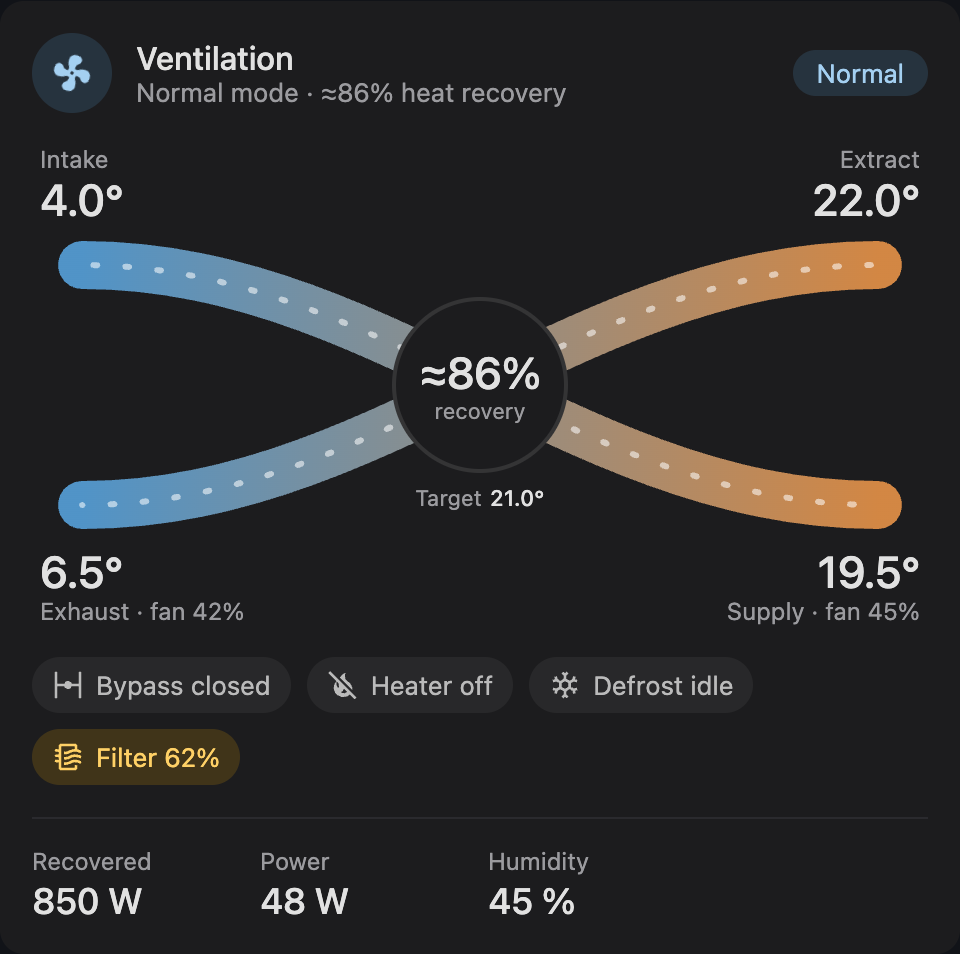
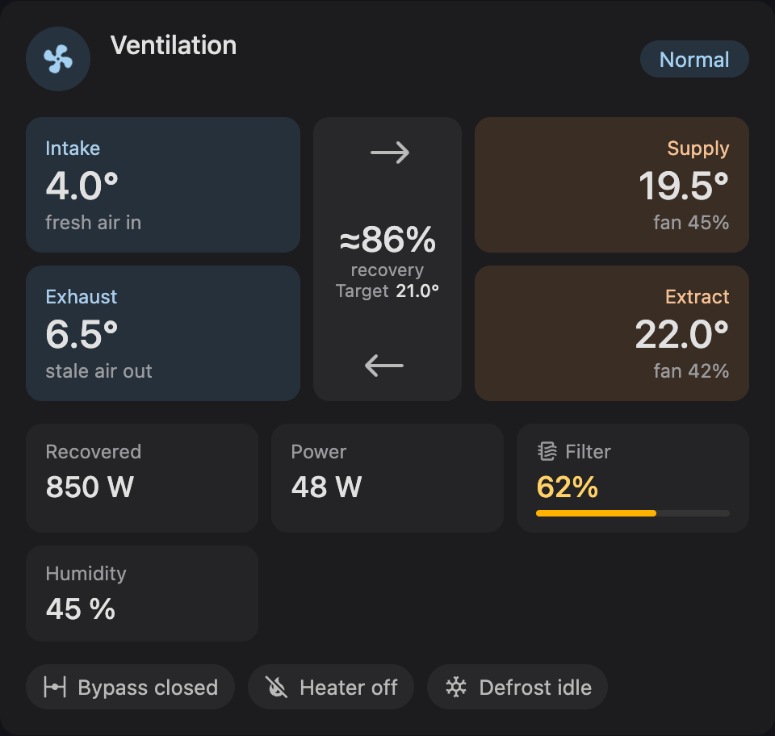
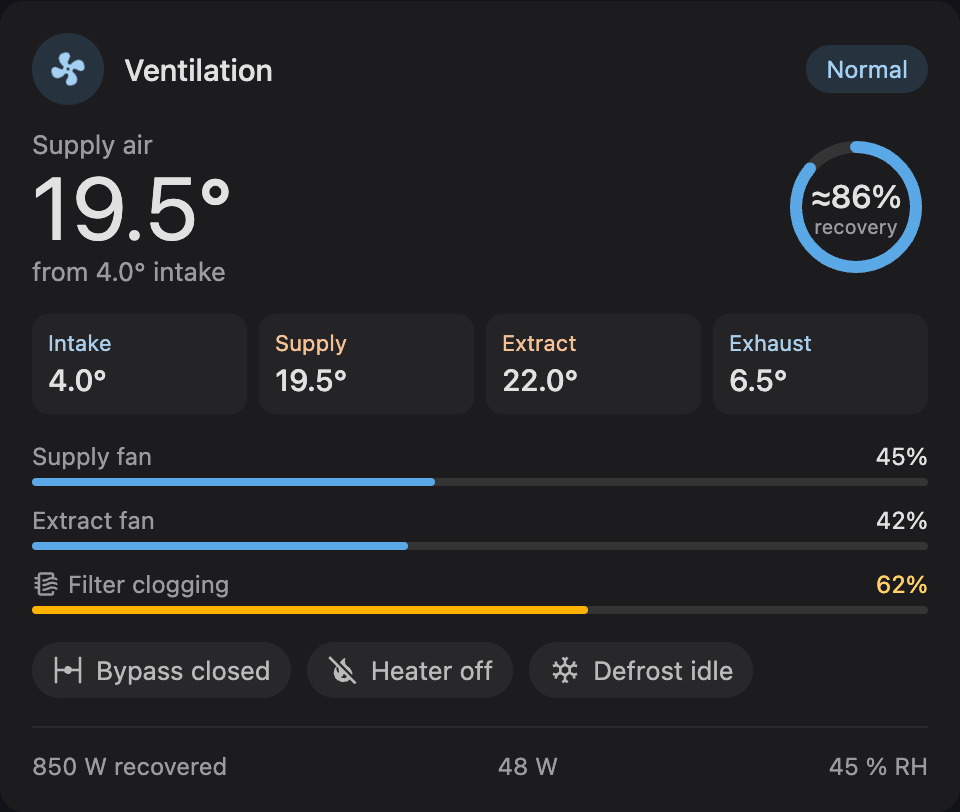
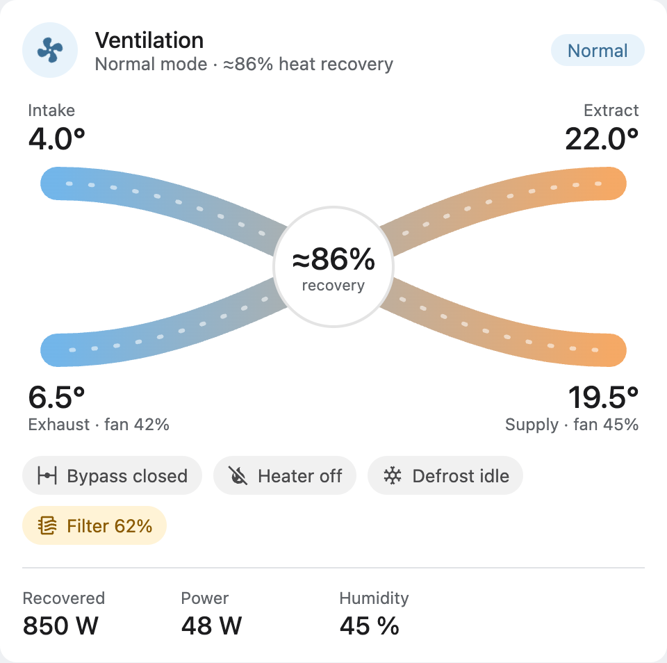
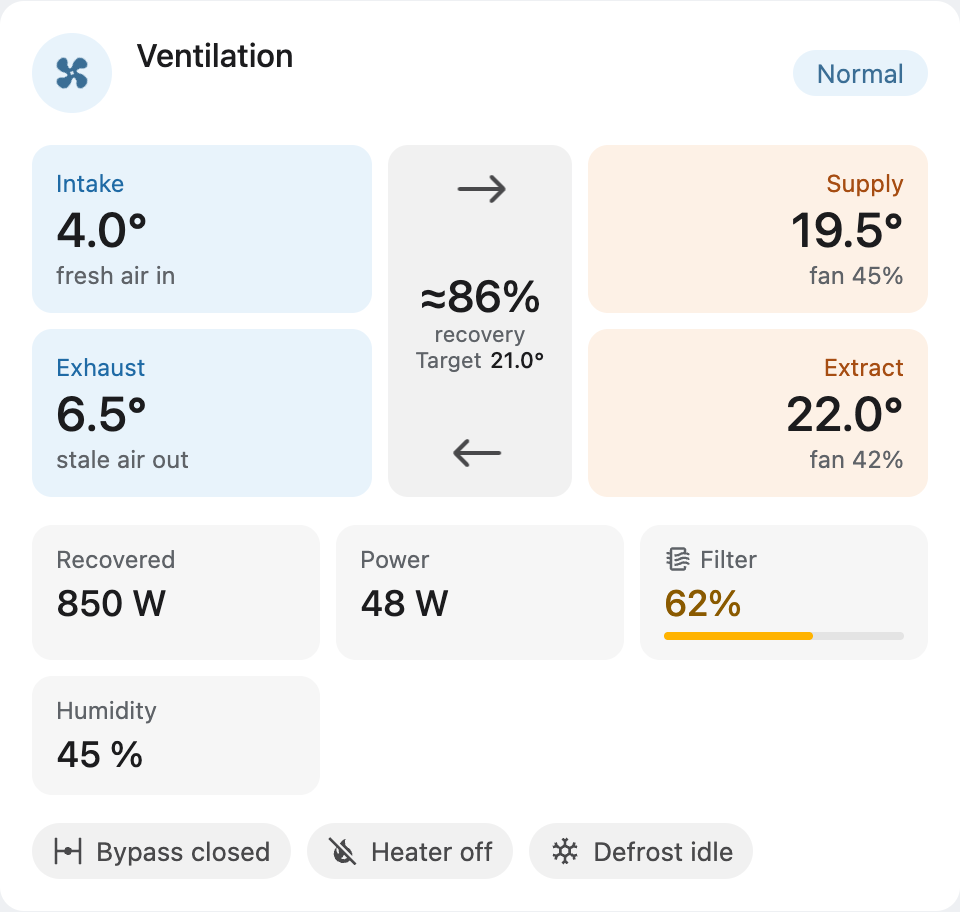
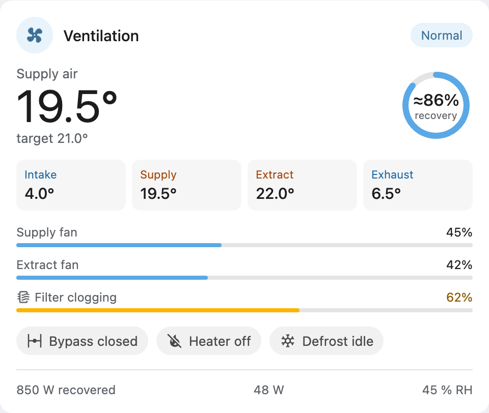

# HRU Card

A Home Assistant dashboard card for heat recovery ventilation units (HRU / ERV / MVHR). It shows
the four air temperatures, fan speeds, heat recovery, filter state and unit status at a glance.
It works with any integration: you map your own entities to roles. The card only displays
state. It never sends commands to your unit; tapping a value opens its more-info dialog.

| Flow                                            | Lanes                                             | Compact                                               |
| ----------------------------------------------- | ------------------------------------------------- | ----------------------------------------------------- |
|    |    |    |
|  |  |  |

- **Three layouts:**
  - `flow`: crossing ducts with moving air.
  - `lanes`: tinted temperature boxes with stat tiles.
  - `compact`: big supply-air temperature with a recovery ring.
- **Motion with meaning:** air and fan speed follow the unit's mode. Everything stops when the unit
  is off or in standby. The `prefers-reduced-motion` setting is respected.
- **Native look:** follows your HA theme, light and dark, and your accent colour.
- **Visual editor:** entity pickers filtered to fitting domains and a short explanation under every field, so no YAML is needed.
- **Card picker suggestions (HA 2026.6+):** when you pick a temperature sensor of a ventilation
  device, the card appears under _Community_, pre-filled with the device's entities.

## Install

### Home Assistant 2026.11 and newer: Marketplace

Until the card is listed in the default catalog, add it as a custom repository:

1. **Settings → Marketplace → ⋮ → Custom repositories.**
2. Repository `https://github.com/kstanelis/hru-card`, type **Dashboard**.
3. Open **HRU Card** and select **Download**. The dashboard resource is added for you.

### Older Home Assistant: HACS

1. **HACS → ⋮ → Custom repositories.** Add `https://github.com/kstanelis/hru-card` with type
   **Dashboard**.
2. Download **HRU Card** and reload the browser.

### Manual

1. Download `hru-card.js` from the [latest release](https://github.com/kstanelis/hru-card/releases/latest)
   into `config/www/community/hru-card/`.
2. **Settings → Dashboards → ⋮ → Resources → Add resource:**
   - URL: `/local/community/hru-card/hru-card.js`
   - Type: _JavaScript module_

## Configuration

Add the card from the dashboard editor (search for "HRU Card") and fill in the fields. In YAML,
the smallest working card maps two temperatures:

```yaml
type: custom:hru-card
supply_temp: sensor.ventilation_supply_temperature
extract_temp: sensor.ventilation_extract_temperature
```

### Entity roles

Every role is optional. At least two of the four temperatures are required; with fewer, the card
shows a hint instead.

| Key               | Meaning                     | Accepted domains                                                   | Read as                                                      |
| ----------------- | --------------------------- | ------------------------------------------------------------------ | ------------------------------------------------------------ |
| `intake_temp`     | Outdoor air entering        | `sensor`                                                           | number                                                       |
| `supply_temp`     | Air sent to rooms           | `sensor`                                                           | number                                                       |
| `extract_temp`    | Stale air pulled from rooms | `sensor`                                                           | number                                                       |
| `exhaust_temp`    | Air leaving the house       | `sensor`                                                           | number                                                       |
| `target_temp`     | Target (set-point) temp     | `sensor`, `number`, `input_number`, `climate`                      | number; `climate` uses its `temperature` attribute           |
| `supply_fan`      | Supply fan speed            | `sensor`, `fan`, `number`                                          | `%`, or `rpm` (scaled by `max_rpm`); `fan` uses `percentage` |
| `extract_fan`     | Extract fan speed           | `sensor`, `fan`, `number`                                          | same                                                         |
| `mode`            | Operating mode              | `select`, `input_select`, `fan`, `climate` (preset mode), `sensor` | text, see [Modes](#modes)                                    |
| `efficiency`      | Heat recovery %             | `sensor`                                                           | number; computed from temperatures when absent               |
| `filter`          | Filter clogging / wear      | `sensor`, `binary_sensor`                                          | `%`, a counter with `filter_limit`, or on = replace          |
| `bypass`          | Bypass damper               | `binary_sensor`, `sensor`, `switch`                                | on / above 0 = open                                          |
| `heater`          | Supply-air heater           | `binary_sensor`, `switch`, `sensor`                                | on / above 0 = heating                                       |
| `defrost`         | Defrost / preheat cycle     | `binary_sensor`, `switch`, `sensor`                                | on / above 0 = active                                        |
| `recovered_power` | Heat recovered              | `sensor`                                                           | number with unit                                             |
| `power`           | Electric consumption        | `sensor`                                                           | number with unit                                             |
| `humidity`        | Indoor humidity             | `sensor`                                                           | number with unit                                             |
| `co2`             | Indoor CO₂                  | `sensor`                                                           | number with unit                                             |
| `airflow`         | Air flow volume             | `sensor`                                                           | number with unit                                             |

An unmapped role removes its element: no empty tile or chip. A mapped entity that is
`unknown` or `unavailable` shows "—" and never drives motion.

When `efficiency` is not mapped, recovery is computed as
`(supply − intake) / (extract − intake) × 100` and shown with "≈". It is hidden when an input is
missing or extract and intake differ by less than 1 °C.

`target_temp` shows a small "Target 21.0°" line under the recovery badge (flow), in the middle
block (lanes), and in place of "from … intake" under the supply-air temperature (compact).

The compact layout always shows supply air as its big temperature; when `supply_temp` is
unmapped or unavailable it shows only "—" (no label), never another temperature.

### Style and behaviour

| Key               | Values                                    | Default                                                           |
| ----------------- | ----------------------------------------- | ----------------------------------------------------------------- |
| `layout`          | `flow`, `lanes`, `compact`                | `flow`                                                            |
| `name`            | text                                      | device name of the `mode` entity (HA 2026.4+), else "Ventilation" |
| `icon`            | any `mdi:` icon                           | `mdi:fan`                                                         |
| `theme`           | `auto`, `light`, `dark`                   | `auto` (follows HA)                                               |
| `accent`          | any CSS colour                            | your theme's `--primary-color`                                    |
| `animations`      | `true`, `false`                           | `true`                                                            |
| `max_rpm`         | number                                    | `3000`                                                            |
| `filter_limit`    | number, same unit as a counter `filter`   | none (filter is a %)                                              |
| `filter_warning`  | 0–100 %                                   | `50`                                                              |
| `filter_critical` | 0–100 %, above `filter_warning`           | `80`                                                              |
| `mode_speeds`     | map of mode name → speed band (YAML only) | built-in words, see below                                         |

### Modes

The mode sets how fast the air moves and the header fan spins. Mode names are matched without
regard to case, `_` or `-`, either as a whole word or as the first word ("Boost 30 min" counts
as boost):

| Band     | Built-in words                      | Fan level |
| -------- | ----------------------------------- | --------- |
| `off`    | off, standby                        | stopped   |
| `low`    | away, eco, holiday, vacation, low   | 25 %      |
| `medium` | normal, home, auto, medium          | 50 %      |
| `high`   | intensive, high, kitchen, fireplace | 75 %      |
| `max`    | boost, max, party, override         | 100 %     |

When fan speeds are mapped, they drive the moving air and the mode drives the header fan. Without
fans, the mode drives both. For your unit's own mode names, use `mode_speeds`:

```yaml
mode_speeds:
  Kitchen hood: high
  Sauna: max
```

### Example: generic unit

```yaml
type: custom:hru-card
layout: lanes
intake_temp: sensor.hru_outdoor_temperature
supply_temp: sensor.hru_supply_temperature
extract_temp: sensor.hru_extract_temperature
exhaust_temp: sensor.hru_exhaust_temperature
supply_fan: sensor.hru_supply_fan_speed
extract_fan: sensor.hru_extract_fan_speed
mode: select.hru_operating_mode
filter: sensor.hru_filter_clogging
bypass: binary_sensor.hru_bypass
heater: binary_sensor.hru_heater
power: sensor.hru_power
```

### Example: Komfovent

> The entity ids below are **examples**. Your ids depend on your Komfovent integration and
> device name, so pick yours in the visual editor or check **Settings → Entities**.

```yaml
type: custom:hru-card
layout: flow
intake_temp: sensor.komfovent_outdoor_temperature
supply_temp: sensor.komfovent_supply_temperature
extract_temp: sensor.komfovent_extract_temperature
exhaust_temp: sensor.komfovent_exhaust_temperature
supply_fan: sensor.komfovent_supply_fan_intensity
extract_fan: sensor.komfovent_extract_fan_intensity
mode: select.komfovent_operation_mode
efficiency: sensor.komfovent_heat_exchanger_efficiency
filter: sensor.komfovent_filter_clogging
heater: sensor.komfovent_electric_heater
recovered_power: sensor.komfovent_heat_exchanger_power
power: sensor.komfovent_power_consumption
```

## Compatibility

Minimum Home Assistant **2024.8**. Newer features are detected and used when present:

| Feature                                   | Needs HA |
| ----------------------------------------- | -------- |
| Card, editor, light/dark, sections sizing | 2024.8   |
| Sections grid sizing (`getGridOptions`)   | 2024.11  |
| Device-based default name                 | 2026.4   |
| Card picker suggestions                   | 2026.6   |
| Marketplace install                       | 2026.11  |

Tested in Home Assistant: _pending, real-HA test matrix not yet run._

## Development

```bash
npm ci
npm run check   # audit, lint, format, types, lit-analyzer, tests with coverage
npm run build   # dist/hru-card.js
```

`dev/index.html` previews all three layouts with fake data and controls for each state. Serve
the repository root with any static server and open `/dev/`.

Releases: bump `version` in `package.json`, merge to `main`, then publish a GitHub release tagged
`v<version>`. The release workflow runs every check and attaches `hru-card.js`.

## License

MIT, see [LICENSE](LICENSE).
